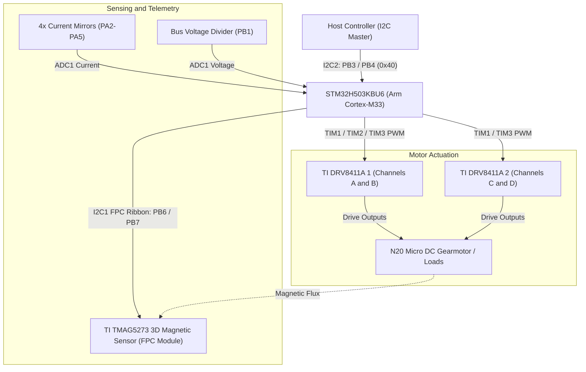
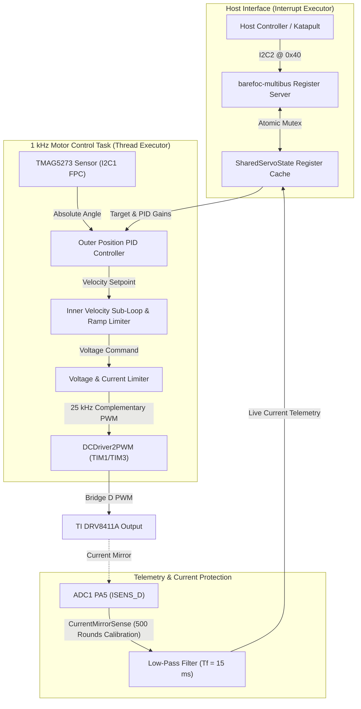

# FishyServo - Closed-Loop Servo Controller for DC motors


> *Something is Fishy; looks like a DC motor driver on the outside, but actually a Servo driver.*

FishyServo is an open-source motor controller board based on the STM32H503KBU6 microcontroller (Arm Cortex-M33, up to 250 MHz) and dual Texas Instruments DRV8411A H-bridge drivers. The board provides 4 independent half/full H-bridge channels with low-side current sensing on each channel. When connected to an external Texas Instruments TMAG5273 3D Hall-effect magnetic sensor via a Flexible Printed Circuit (FPC) ribbon cable, the system operates as a closed-loop servo controller with absolute angular position feedback, dual isolated I2C buses, and Katapult / BareBoot bootloader support.

---

## Key Features

- **Dual-Mode Operation**: Configurable as a 4-channel independent DC motor/load driver or as a closed-loop servo controller with angular feedback.
- **Microcontroller**: STM32H503KBU6 (Arm Cortex-M33 with FPU/DSP, 64 to 250 MHz, 128 KB Flash, 32 KB SRAM, UFQFPN-32).
- **H-Bridge Motor Drivers**: Two TI DRV8411ARTE ICs providing 4 H-bridge channels (up to 1.5 A peak per bridge) for micro DC motors and directional loads.
- **External Magnetic Sensor Interface**: Connects an external TI TMAG5273 3D Hall-effect sensor over an FPC ribbon cable to dedicated internal bus `I2C1` for angular tracking.
- **Dual Isolated I2C Buses**:
  - **Host Bus (`I2C2` on `PB3` / `PB4`)**: External interface for host communication and firmware updates via Katapult / BareBoot (Target Address `0x40`).
  - **Sensor Bus (`I2C1` on `PB6` / `PB7`)**: Dedicated internal channel isolating sensor transactions from host traffic.
- **Four-Channel Current Sensing**: Low-side current mirror circuits ($A_{IPROPI} = 200\ \mu\text{A/A}$) with 1 kΩ shunt resistors on channels A through D, sampled via 12-bit ADC1.
- **Bus Voltage Monitoring**: Resistor divider on `PB1` (`VSENS`) for DC bus voltage measurement.
- **`#![no_std]` Rust Firmware**: Implemented using the Embassy asynchronous framework (`embassy-stm32`) for task scheduling, motion control, and telemetry streaming.
- **N20 Form Factor**: Board dimensions matched to standard N20 micro gearmotors.

---

## Hardware Specifications

### Core Specifications

| Specification | Value | Notes |
|---|---|---|
| Microcontroller | STM32H503KBU6 | Arm Cortex-M33 @ 64–250 MHz, 128 KB Flash, 32 KB SRAM |
| Motor Drivers | 2 × TI DRV8411ARTE | Dual H-bridge drivers (4 channels: A, B, C, D), 1.5 A peak per bridge |
| Logic Voltage | 3.3 V nominal | Onboard LDO supply, decoupled analog VDDA rail |
| Motor Supply | 3.0 V to 6.0 V | Sensed via resistor divider on `PB1` (`VSENS`) |
| Position Sensor | TI TMAG5273 (FPC) | 3D Hall-effect magnetic sensor on internal `I2C1` (`PB6`/`PB7`) via FPC ribbon |
| Host Bus | I2C (`I2C2`) | `PB3` (SCL) / `PB4` (SDA), Target Address `0x40` |
| Current Sensing | 4 × Low-Side Mirrors | $200\ \mu\text{A/A}$ mirror into 1 kΩ resistor ($V_{ISENS} = 0.2\text{ V/A}$) |
| Programming & Debug | SWD | SWDIO (`PA13`), SWCLK (`PA14`), USART1 (`PA11`/`PA12`) |
| Status Indicators | Dual LEDs | Blue (`PA0`), Red (`PA1`), active-LOW common anode |

### Operating Modes

| Mode | External Sensor FPC | Active Channels | Control Paradigm | Target Application |
|---|---|---|---|---|
| **Quad DC Driver** | Disconnected / Unfitted | Channels A, B, C, D | Open-loop PWM / Voltage / Velocity | Multi-motor drive, directional DC actuators, solenoids, or resistive loads |
| **Closed-Loop Servo** | Connected via FPC (`I2C1`) | Channel D (or A–C configured) | Cascaded Position/Velocity PID with 3D angle feedback | Angular position control, robotic joints, micro linear actuators, N20 gearmotors |

### H-Bridge Channel Allocation & Pin Mapping

| Channel | Driver IC | Input 1 (`IN_x1`) | Input 2 (`IN_x2`) | Timer PWM Channels | Current Sense Pin | ADC Channel | Default Boot State |
|:---:|:---:|:---:|:---:|:---:|:---:|:---:|:---|
| **Bridge A** | U1 (DRV8411A) | `PA15` | `PB5` | TIM2_CH1 / TIM3_CH2 | `PA2` | ADC1_INP14 | Hi-Z Coast (0, 0) |
| **Bridge B** | U1 (DRV8411A) | `PA8` | `PB15` | TIM1_CH1 / TIM1_CH3N | `PA3` | ADC1_INP15 | Hi-Z Coast (0, 0) |
| **Bridge C** | U2 (DRV8411A) | `PA6` | `PA7` | TIM3_CH1 / TIM3_CH2 | `PA4` | ADC1_INP18 | Hi-Z Coast (0, 0) |
| **Bridge D** | U2 (DRV8411A) | `PA9` | `PB0` | TIM1_CH2 / TIM3_CH3 | `PA5` | ADC1_INP19 | Active Servo PWM |

### DRV8411A IN/IN Control Logic

| `IN_x1` | `IN_x2` | Output State | Function | Description |
|:---:|:---:|:---:|:---|:---|
| **0** | **0** | Hi-Z | **Coast** | Outputs disabled, high impedance; zero quiescent drive current |
| **1** | **0** | OUT1=H, OUT2=L | **Forward** | Forward rotation / high-side to low-side conduction |
| **0** | **1** | OUT1=L, OUT2=H | **Reverse** | Reverse rotation / low-side to high-side conduction |
| **1** | **1** | OUT1=L, OUT2=L | **Brake** | Low-side slow decay; dynamic braking |

### Dual I2C Bus Topology & Address Isolation

| Bus Domain | Peripheral | Clock Pin | Data Pin | Target / Speed | Devices & Roles | Isolation Function |
|---|---|---|---|---|---|---|
| **Host Bus** | `I2C2` | `PB3` (AF8) | `PB4` (AF8) | Target `0x40`<br>100–400 kHz | Host master, BareBoot Katapult bootloader, `barefoc-multibus` register server | Isolates host register transactions and bootloader communications from sensor bus traffic |
| **Sensor Bus** | `I2C1` | `PB6` (AF4) | `PB7` (AF4) | Master<br>50–100 kHz | TI TMAG5273 3D Hall sensor (FPC connector) | Maintains deterministic sensor polling rates without host arbitration delays or clock stretching |

### Power & Clock Regimes

| Regime | System Clock Source | Frequency | Voltage Scale | Typical Die Temp | Target Operating Condition |
|---|---|---|---|---|---|
| **Nominal** | Internal HSI (`RCC_HSI_DIV1`) | 64 MHz | Scale 3 (Low Power) | ~40–45 °C | Continuous closed-loop servo operation with lower thermal dissipation |
| **High Frequency** | PLL1 via CSI / HSI48 | Up to 250 MHz | Scale 0 (Boost) | ~60–70 °C | High-rate current control loops and high-throughput telemetry |

### Implementation Notes

- **Current Sensing Calibration**:
  - Current mirror ratio: $A_{IPROPI} = 200\ \mu\text{A/A}$ (1:5000 ratio).
  - Shunt resistor: $R_{SENS} = 1000\ \Omega$.
  - Transfer function:
    $$V_{ISENS} = I_{motor} \times A_{IPROPI} \times R_{SENS} = I_{motor} \times (200 \times 10^{-6}\text{ A/A}) \times 1000\ \Omega = I_{motor} \times 0.2\text{ V/A}$$
    $$I_{motor} = \frac{V_{ISENS}}{0.2\text{ V/A}} = 5.0 \times V_{ISENS}$$
  - Resolution: 12-bit ADC count $\approx \frac{3.3\text{ V}}{4095 \times 0.2\text{ V/A}} \approx 4.029\text{ mA/count}$ with full-scale range up to 16.5 A.
- **Safe Boot Coast Mode**:
  - To prevent startup transients during power-up, all bridge inputs (`IN_A1`, `IN_A2`, `IN_B1`, `IN_B2`, `IN_C1`, `IN_C2`) are initialized to logic `LOW` (`Level::Low`) before PWM timer configuration.
- **Active-Low LED Polarity**:
  - `LED_B` (`PA0`) and `LED_R` (`PA1`) are tied to 3.3V via 1 kΩ series resistors. Driving the GPIO `LOW` illuminates the LED.
- **SWD Debug Preservation**:
  - `PA13` (`SWDIO`) and `PA14` (`SWCLK`) are preserved from GPIO reconfiguration. `DBGMCU` stop/standby debug clocks remain enabled on boot to maintain SWD connection during Embassy `WFE`/`WFI` sleep periods.

---

## Hardware Architecture & Pinout

### System Architecture



### Complete Pinout Table

| Pin # | Pin Name | Net Label | Mode / Peripheral | Function | Description |
|:---:|:---|:---|:---|:---|:---|
| **1** | `VDD` | `3V3` | Power Supply | Power | Digital 3.3V supply (Decoupled by C2 4.7µF, C9 100nF) |
| **2** | `PC14-OSC32_IN` | *NC* | None | Unused | No external crystal fitted |
| **3** | `PC15-OSC32_OUT`| *NC* | None | Unused | No external crystal fitted |
| **4** | `NRST` | `RST` | Reset | Control | Active-low system reset (10 kΩ pull-up R31 to 3V3) |
| **5** | `VDDA/VREF+` | `3V3` | Analog Power | Power | Analog supply & reference (Decoupled by C37 4.7µF, C20 100nF) |
| **6** | `PA0` | `LED_B` | GPIO Output | Indicator | Blue Status LED (Active LOW, common anode to 3V3) |
| **7** | `PA1` | `LED_R` | GPIO Output | Indicator | Red Status LED (Active LOW, common anode to 3V3) |
| **8** | `PA2` | `ISENS_A` | ADC1_INP14 | Telemetry | Driver Channel A Current Sense feedback |
| **9** | `PA3` | `ISENS_B` | ADC1_INP15 | Telemetry | Driver Channel B Current Sense feedback |
| **10**| `PA4` | `ISENS_C` | ADC1_INP18 | Telemetry | Driver Channel C Current Sense feedback |
| **11**| `PA5` | `ISENS_D` | ADC1_INP19 | Telemetry | Driver Channel D Current Sense feedback |
| **12**| `PA6` | `IN_C1` | TIM3_CH1 / GPIO | Motor Driver | Channel C PWM / Direction Input 1 |
| **13**| `PA7` | `IN_C2` | TIM3_CH2 / GPIO | Motor Driver | Channel C PWM / Direction Input 2 |
| **14**| `PB0` | `IN_D2` | TIM3_CH3 / GPIO | Motor Driver | Channel D PWM / Direction Input 2 |
| **15**| `PB1` | `VSENS` | ADC1_INP1 | Telemetry | Motor / Bus Supply Voltage sense divider |
| **16**| `VCAP` | `VCAP` | Internal Regulator | Power | LDO core supply bypass (C6 4.7µF to GND) |
| **17**| `VDD` | `3V3` | Power Supply | Power | Digital 3.3V supply (Decoupled by C1 4.7µF, C7 100nF) |
| **18**| `PB15`| `IN_B2` | TIM1_CH3N / GPIO | Motor Driver | Channel B PWM / Direction Input 2 |
| **19**| `PA8` | `IN_B1` | TIM1_CH1 / GPIO | Motor Driver | Channel B PWM / Direction Input 1 |
| **20**| `PA9` | `IN_D1` | TIM1_CH2 / GPIO | Motor Driver | Channel D PWM / Direction Input 1 |
| **21**| `PA11`| `RX` | USART1_RX (AF7) | Serial Comms | UART Receive (routed to test point TP2) |
| **22**| `PA12`| `TX` | USART1_TX (AF7) | Serial Comms | UART Transmit (routed to test point TP1) |
| **23**| `PA13`| `SWDIO` | SWDIO (AF0) | Debug | Serial Wire Debug Data (SWD) |
| **24**| `PA14`| `SWCLK` | SWCLK (AF0) | Debug | Serial Wire Debug Clock (SWD) |
| **25**| `PA15`| `IN_A1` | TIM2_CH1 / GPIO | Motor Driver | Channel A PWM / Direction Input 1 |
| **26**| `PB3` | `SCL` | I2C2_SCL (AF8) | Host Comms | Host I2C Clock (BareBoot bootloader target) |
| **27**| `PB4` | `SDA` | I2C2_SDA (AF8) | Host Comms | Host I2C Data (BareBoot bootloader target) |
| **28**| `PB5` | `IN_A2` | TIM3_CH2 / GPIO | Motor Driver | Channel A PWM / Direction Input 2 |
| **29**| `PB6` | `3D_SCL` | I2C1_SCL (AF4) | Sensor Bus | 3D Magnetic Sensor I2C Clock |
| **30**| `PB7` | `3D_SDA` | I2C1_SDA (AF4) | Sensor Bus | 3D Magnetic Sensor I2C Data |
| **31**| `BOOT0`| `BOOT` | Boot Selector | Control | Boot configuration (10 kΩ pull-down R30 to GND) |
| **32**| `PB8` | *NC* | None | Unused | Unconnected / Not bonded out |
| **33**| `EP` | `GND` | Ground Pad | Ground | Central thermal & ground pad to system GND |

---

## Mechanical Assembly

### Motor Form Factor & Mounting
- **Target Motor**: Standard micro N20 DC brushed metal gearmotor (nominal cross-section 12 × 10 mm) or auxiliary DC loads.
- **Gear Reduction Compatibility**: Compatible with standard N20 reduction gearboxes (e.g. 50:1, 100:1, 150:1, 298:1).
- **External FPC Sensor Tail**: The TI TMAG5273 3D magnetic position sensor is mounted on a flexible printed circuit (FPC) that connects to the FishyServo board via an FPC connector. This isolates the sensor IC from board mechanical constraints and enables placement directly at the rear shaft or output horn of the gearmotor.
- **Magnetic Angle Tracking**: In closed-loop servo mode, a diametrically magnetized cylindrical neodymium magnet (such as 4 × 2 mm or 6 × 2.5 mm) is aligned axially on the motor shaft or output horn directly over the TMAG5273 package to supply magnetic flux vectors for XY angle computation.

---

## Firmware & Control System

Firmware source files and build configurations are located in the [firmware/](https://github.com/rambros3d/FishyServo/tree/main/firmware) directory.

### Control Pipeline Architecture



### MultiBus Register Map

The host interface exposes a register map through `barefoc-multibus` over `I2C2` (Target Address `0x40`):

| Register ID | Name | Type | Access | Units / Description |
|:---:|:---|:---:|:---:|:---|
| `0x00` | `Status` | `u8` | R | Controller status flags (0: Uninit, 1: Ready, 2: Fault) |
| `0x01` | `Target` | `f32` | R/W | Motion target: angle in radians (Mode 0), rad/s (Mode 1), or Volts (Mode 2) |
| `0x02` | `Enable` | `u8` | R/W | Motor driver bridge enable (0: Hi-Z Coast, 1: Active) |
| `0x03` | `ControlMode` | `u8` | R | Operating mode: 0 = Angle (Closed-loop), 1 = Velocity Open-loop, 2 = Voltage |
| `0x04` | `Angle` | `f32` | R | Filtered shaft angle in radians from TMAG5273 |
| `0x05` | `Velocity` | `f32` | R | Angular velocity in radians per second |
| `0x06` | `CurrentDC` | `f32` | R | Motor current in milliamperes (mA) |
| `0x10` | `AngPidP` | `f32` | R/W | Angle loop proportional gain ($P_{angle}$) |
| `0x11` | `VelPidP` | `f32` | R/W | Velocity sub-loop proportional gain ($K_p$) |
| `0x12` | `VelPidI` | `f32` | R/W | Velocity sub-loop integral gain ($K_i$) |
| `0x13` | `VelPidD` | `f32` | R/W | Velocity sub-loop derivative gain ($K_d$) |
| `0x20` | `VoltageLimit` | `f32` | R/W | Driver output voltage limit in Volts |
| `0x21` | `VelocityLimit` | `f32` | R/W | Velocity limit in radians per second |

### Bootloader & Upload Guide

- **BareBoot / Katapult Bootloader**:
  - Located in Sector 0 of flash memory.
  - Receives firmware updates over the external `I2C2` interface (`PB3` SCL / `PB4` SDA) at target address `0x40` using Katapult host tooling:
    ```bash
    python3 katapult/scripts/flashtool.py --ch341 -a 0x40 -f firmware.bin
    ```
  - An I2C target write of byte `[0xF0]` initiates software reset into bootloader mode.
- **Direct SWD Flashing**:
  - Connect a debug probe (e.g. Raspberry Pi Debugprobe or ST-Link) to `PA13` (SWDIO), `PA14` (SWCLK), and `GND`:
    ```bash
    cargo run --release
    ```

---


This project's PCB and PCBA service was sponsored by the [OSHWLab Spark campaign](https://oshwlab.com/).
